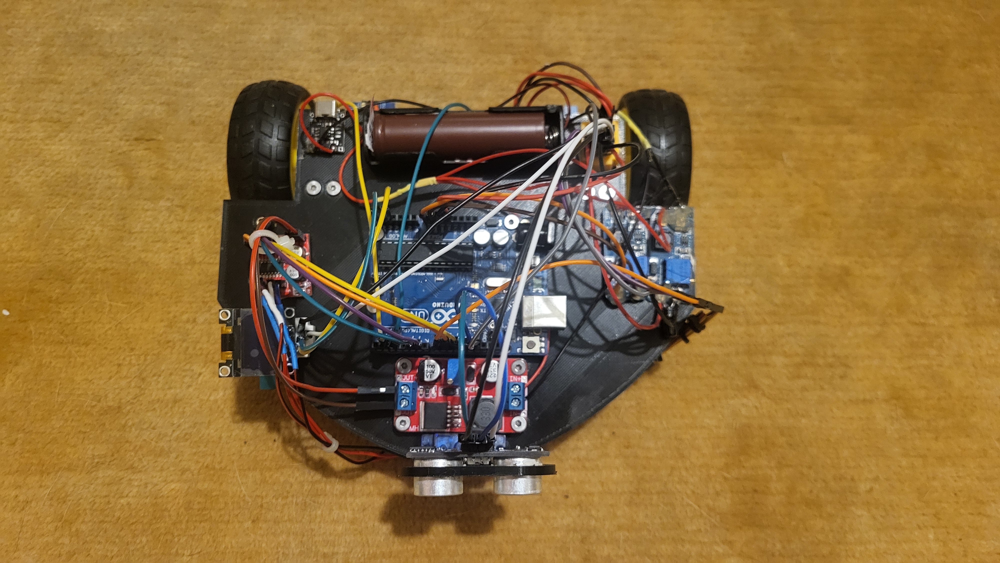
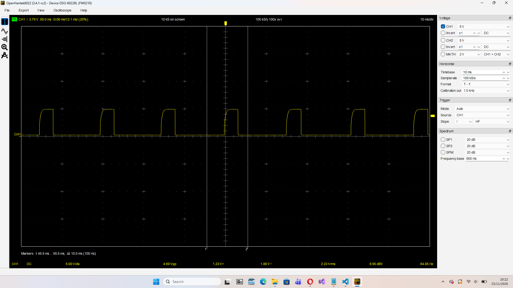

Autonomous Obstacle Avoidance Robot

An Arduino Uno-based autonomous mobile robot featuring independent PID motor speed control, wheel encoder feedback, and ultrasonic obstacle detection.

The robot autonomously navigates its surroundings by measuring distances in multiple directions and selecting an appropriate movement direction. Its motor speeds are regulated using two independent PID controllers.

Project Overview

The main objective of this project was to develop an autonomous robot while gaining practical experience with embedded C++, motor control, sensors, interrupts, feedback systems, and state-machine-based programming.

The robot is currently fully operational. PID parameters and movement behaviour are still being tuned and refined to improve its accuracy, stability, and overall performance.

Media and Development

Robot Demonstration

A demonstration of the robot operating autonomously, detecting obstacles and navigating around them.

"Watch the robot demonstration" (INSERT_VIDEO_LINK_HERE)

Robot Photographs

Complete robot

Electronics and wiring

"Electronics and wiring" (assets/images/robot-electronics.jpg)

Sensor and motor assembly

"Sensor and motor assembly" (assets/images/robot-hardware-detail.jpg)

Oscilloscope Measurements

During development, an oscilloscope was used to inspect the signal generated by the optical encoder sensor. This helped investigate the sensor output and verify its signal behaviour during debugging. At first the signal generated from the encoder was unstable thus I added 1 68nF ceramic capacitor on each encoder in parallel with signal and ground.

Hardware

Component| Purpose
Arduino Uno R3| Main microcontroller
L298N| Dual DC motor driver
DC motors with encoders| Robot propulsion and speed feedback
HC-SR04| Ultrasonic distance measurement
Servo motor| Rotates the ultrasonic sensor
SSD1306 OLED| Display and system information

Software Architecture

The software is written in C++ and developed using PlatformIO.

The code is separated into modules to keep hardware configuration, control logic, and PID implementation independent.

Main software elements:

- State machine: Controls the robot's operating modes and movement transitions.
- Encoder feedback: Uses hardware interrupts to count wheel encoder pulses.
- PID controllers: Two independent PID instances regulate the left and right motor speeds.
- Ultrasonic sensing: Measures distances in front of the robot and to either side.
- Servo control: Positions the ultrasonic sensor for obstacle detection.
- OLED display: Provides visual system information.

PID Motor Speed Control

Each motor has its own PID controller, allowing independent speed regulation.

Wheel encoder pulses are counted using external interrupts. At regular measurement intervals, the measured wheel speeds are calculated and passed to the corresponding PID controller.

The controllers calculate corrections to the motor PWM signals based on the difference between the target and measured speeds.

Current target speed: 140 RPM

The PID controllers are operational, but their parameters are still being tuned to improve speed regulation and compensate for differences between the two motors.

Obstacle Detection and Avoidance

An HC-SR04 ultrasonic sensor mounted on a servo motor measures distances in three directions:

- Front
- Left
- Right

After collecting the measurements, the robot evaluates the available directions and selects its next movement.

If neither left nor right provides a suitable path, the robot performs a U-turn.

Movement Control

The robot uses encoder pulse counts to control turning movements.

The current movement logic includes:

- Forward movement
- Left turn
- Right turn
- 180-degree turn

A state-machine approach separates sensing, decision-making, and movement execution.

Current Status and Future Improvements

Current status: Operational prototype.

Planned improvements:

- Further PID parameter tuning.
- Improve motor speed consistency.
- Refine turning accuracy.
- Improve obstacle detection reliability.
- Further optimize state transitions and movement behaviour.

Repository Structure

- "include/" – Hardware configuration and declarations.
- "src/" – Main program, robot control functions, and PID implementation.
- "lib/" – PlatformIO project libraries.
- "test/" – PlatformIO test directory.
- "assets/images/" – Robot photographs and oscilloscope captures.

Getting Started

1. Clone this repository.
2. Open the project in Visual Studio Code with PlatformIO installed.
3. Connect the Arduino Uno.
4. Build and upload the firmware.
